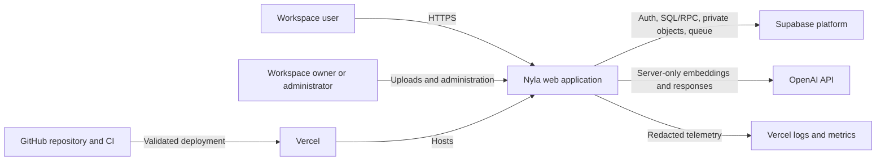
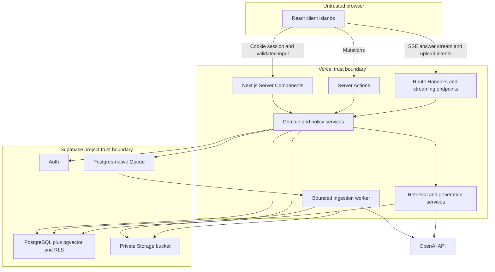
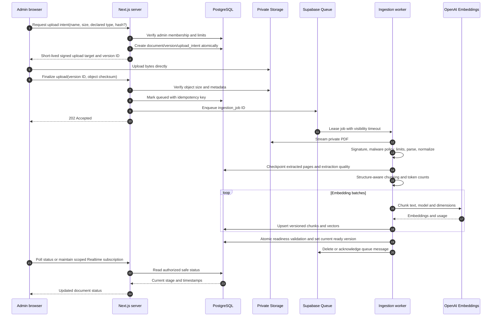
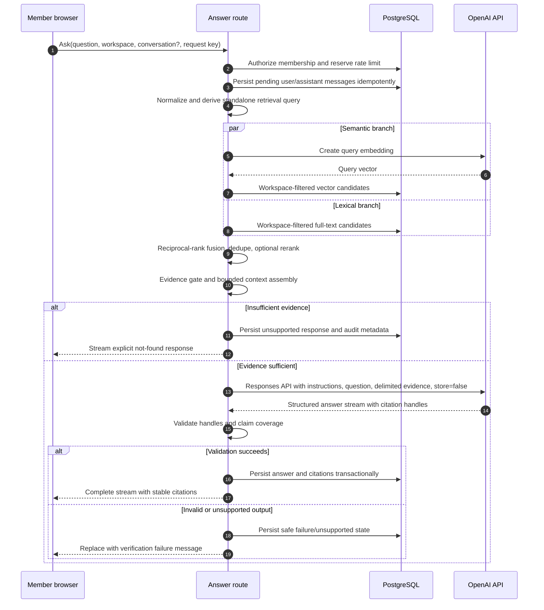
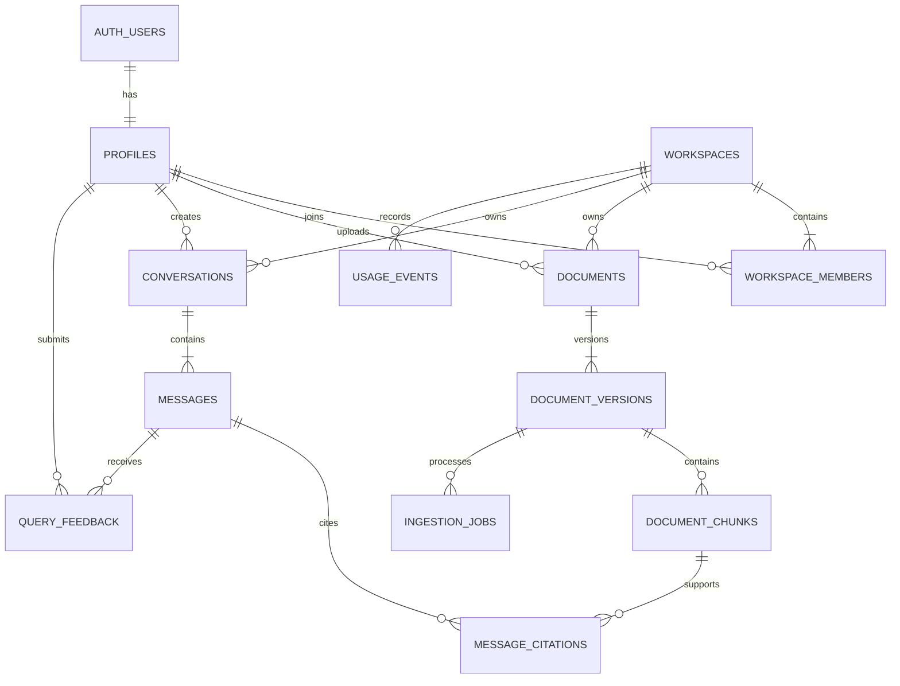
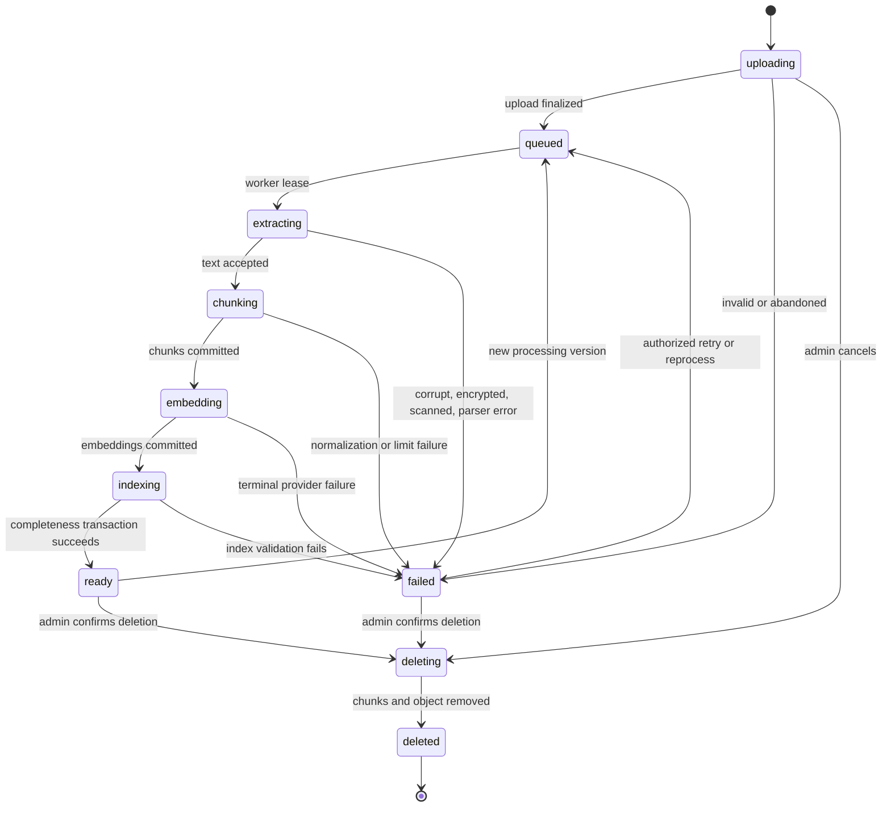
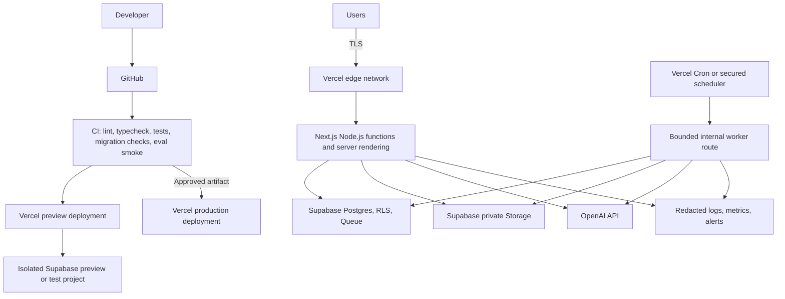

# 02 — System Architecture

**Status:** Draft for architecture review  
**Scope:** MVP production topology  
**Related:** [Technical design](03-technical-design-document.md), [data design](05-database-and-data-design.md), [RAG design](06-rag-pipeline-design.md), [security](07-security-and-privacy-design.md)

## 1. Architecture goals

1. Enforce workspace isolation at every data boundary, including vector and full-text retrieval.
2. Produce answers whose evidence can be resolved to immutable document versions and pages.
3. Keep the deployment understandable and operable by one developer.
4. Isolate slow, retryable ingestion from interactive requests.
5. Make all external effects idempotent or safely repeatable.
6. Scale vertically and by bounded worker concurrency before adding services.
7. Preserve the ability to replace models, extractors, and rerankers through versioned service interfaces.
8. Fail closed: if identity, authorization, retrieval scope, citation validation, or provider state is uncertain, do not return tenant data or a grounded-success response.

## 2. System context



Nyla owns retrieval, prompt construction, citation validation, conversations, and product behavior. OpenAI does not own the source of truth or conversation persistence. Supabase does not decide product roles by JWT user metadata; membership rows are authoritative.

## 3. Major components

| Component | Responsibility | Does not do |
|---|---|---|
| Next.js web UI | Server-rendered navigation, interactive Ask/search/viewer, accessible states | Hold secret keys or decide authorization alone |
| Application server | Session validation, workspace authorization, mutations, streaming orchestration, signed URL brokering | Trust browser-supplied tenant scope |
| Domain services | Documents, membership, conversations, retrieval, generation, citations, usage | Import React/UI code |
| Supabase Auth | Identity, verification, password reset, cookie-backed sessions | Store workspace roles in editable user metadata |
| PostgreSQL | Durable metadata, membership, chunks, FTS, vectors, conversations, RLS | Expose unrestricted public tables |
| Supabase Storage | Private original PDFs under tenant/version paths | Issue public document URLs |
| Supabase Queues | Durable ingestion messages and visibility-timeout retries | Contain raw PDF bytes or secrets |
| Ingestion worker | Validate, extract, normalize, chunk, embed, index, checkpoint | Serve interactive UI |
| OpenAI APIs | Generate embeddings and grounded structured answer candidates | Access Storage/Postgres directly or persist product conversations |
| Observability | Redacted structured logs, metrics, alerts, traces | Store routine raw questions or document text |

## 4. High-level component architecture



## 5. Trust boundaries and identity

- **Browser boundary:** all IDs, roles, MIME values, filenames, retrieval options, and citation IDs are attacker-controlled.
- **Application boundary:** server code validates the session with Supabase, resolves the workspace membership from Postgres, enforces role permissions, and passes tenant scope explicitly.
- **Database boundary:** RLS repeats the membership check. Retrieval runs in a tenant-aware database function whose workspace argument must match an active membership; it cannot be a generic `SECURITY DEFINER` vector search.
- **Storage boundary:** objects are private. Object paths start with the authoritative workspace/document-version IDs. Upload and read URLs are short-lived and issued after authorization.
- **Worker boundary:** the worker uses a server secret only for narrowly scoped background operations and rechecks the workspace/job/document relationship before every stage. Queue messages contain record IDs, not authoritative metadata.
- **Provider boundary:** selected chunks and user question leave the Nyla infrastructure for model processing. This data transfer is disclosed, minimized, region-reviewed, and invoked with provider storage disabled where supported.

## 6. Client–server interaction

- Server Components perform authenticated reads directly through a user-scoped Supabase server client. Authenticated responses are dynamic/private and never shared-cached.
- Server Actions handle internal form mutations such as workspace name changes, member actions, and conversation rename/delete.
- Route Handlers exist for upload intents/finalization, answer streaming, search endpoints needed by client interactions, PDF proxy/signed URL issuance, health checks, and the authenticated internal worker.
- Client Components are limited to interaction-heavy areas: upload progress, search/filter controls, streaming answer rendering, evidence drawer, PDF controls, feedback, and responsive navigation.
- Every mutation accepts a validated schema and returns the common error envelope. UI optimistic updates are used only when reversal is safe.

## 7. Authentication and workspace authorization

```mermaid
sequenceDiagram
    participant B as Browser
    participant P as Next.js proxy
    participant S as Server route/component
    participant A as Supabase Auth
    participant D as PostgreSQL with RLS

    B->>P: Request with secure session cookies
    P->>A: Refresh or validate session when required
    A-->>P: User identity and refreshed cookies
    P->>S: Forward request; never authorize from pathname alone
    S->>A: Verify claims/user for protected operation
    S->>D: Query membership(workspace_id, auth.uid())
    D-->>S: Active role or no row under RLS
    alt Active member and permitted role
      S->>D: Tenant-scoped operation
      D-->>S: Authorized rows only
      S-->>B: Private response
    else Missing or insufficient membership
      S-->>B: 401 or 403 without resource details
    end
```

The proxy refreshes session cookies and applies coarse route protection. It is not the authorization layer. Protected server code and RLS are authoritative. Authenticated routes use `Cache-Control: private, no-store`, particularly when session refresh can set cookies.

## 8. Document upload and ingestion



The worker never acknowledges before a durable checkpoint. Retries use the same `ingestion_job.id`, `processing_version`, content hash, and deterministic chunk keys. Readiness is atomic: partially indexed versions never enter retrieval.

## 9. RAG question-answering



Context is data, never instruction. Chunk content is delimited and labeled with opaque source handles generated by the server. A model cannot create a valid citation by guessing an ID because the validator accepts only handles from the selected context.

## 10. Data flow

1. Original PDF bytes: browser → private Storage; worker reads by authorized internal credentials.
2. Extracted page text: worker memory/checkpoint → `document_chunks`; never sent back as a complete document unless a user opens authorized source pages.
3. Embedding input: normalized chunk text → OpenAI → vector stored with model/dimension/processing version.
4. Question: browser → Nyla; normalized query embedding and selected evidence only → OpenAI.
5. Answer: structured provider output → server validation → messages/citations → streamed UI.
6. Telemetry: IDs, stages, durations, counts, model/version, tokens, and error classes → logs/metrics; raw private content excluded.

## 11. Database entity relationships



## 12. Document lifecycle



Status transitions occur through one constrained database function/transaction, with timestamps and an ingestion-job event trail. Retrieval accepts only `documents.status = 'ready'`, the current ready version, and `deleted_at is null`.

## 13. Error handling and recovery

### Interactive operations

- Errors use a stable code, safe message, correlation ID, retryability, and optional field details.
- 401 means no valid identity; 403 means identity lacks permission; 404 may intentionally mask existence across tenants; 409 denotes lifecycle/idempotency conflict; 422 denotes valid transport but invalid content; 429 includes retry guidance; 503 covers transient dependencies.
- Stream protocol emits `metadata`, `delta`, `citation`, `complete`, or `error` events. A disconnected client can reload the persisted message state by request ID.

### Background work

- Transient failures use exponential backoff with jitter and a maximum attempt policy by stage.
- Permanent categories (encrypted, no extractable text, parser safety rejection, configured limit) do not retry automatically.
- A queue visibility timeout greater than the bounded stage duration prevents duplicate active work; a job lease and heartbeat protect against stale workers.
- Dead-letter status retains safe diagnostics and permits an administrator reprocess after configuration/library changes.
- Provider calls store request fingerprints and usage; retries avoid duplicate database writes, though provider billing cannot always be deduplicated after an ambiguous network failure.

## 14. Deployment topology



Use the Node.js runtime by default. PDF libraries, streaming, and database/provider clients do not justify Edge limitations. Git-integrated previews are automatic; production promotion is gated on CI and migration compatibility. Database migrations follow expand → deploy compatible application → backfill → contract, with a restore-tested backup before destructive changes.

## 15. Scaling strategy

### First scaling moves

- Add cursor pagination and avoid unbounded lists from the start.
- Batch embeddings and chunk writes; cap worker concurrency per workspace and globally.
- Index all foreign keys, RLS predicates, document lifecycle filters, `tsvector`, and vector distance.
- Use HNSW cosine index after measuring recall and query plans; exact scans are acceptable for tiny datasets.
- Separate interactive and worker connection budgets through Supabase's supported pooler modes.
- Cache only non-sensitive static marketing content and safe immutable metadata. Do not shared-cache authenticated responses.

### Later triggers

- Partition `usage_events` by month only when retention/volume demonstrates the need.
- Split worker deployment from the web project if queue delay or function ceilings remain unacceptable after staged work.
- Consider a dedicated reranking API only if evaluation shows material gains relative to cost/latency.
- Add collection ACLs only with a redesigned authorization and retrieval filter, not as an application-only flag.

## 16. Failure scenarios

| Failure | User effect | Detection | Recovery |
|---|---|---|---|
| Storage upload interrupted | Upload remains incomplete | Upload intent expiry | Resume if supported or discard intent/object |
| PDF parser crashes | Document fails safely | Worker stage/error metric | Isolate input, update parser, reprocess |
| Queue consumer unavailable | Status stays queued | Queue age alert | Restore worker; durable message remains |
| OpenAI embeddings unavailable | Ingestion/search query delayed | Provider error/rate metric | Backoff; keep current versions untouched |
| Generation stream disconnects | Partial UI response | Stream/client and pending-message age | Reload persisted state or safe retry with request key |
| Database unavailable | Product unavailable; no provider call | Health/error alerts | Fail closed; retry after DB recovery |
| Citation validator fails | No answer success shown | Citation-failure metric | Persist verification failure/unsupported response |
| Membership revoked mid-session | Next request forbidden | RLS/auth audit | Recheck each operation; signed URLs expire quickly |
| Delete worker partly fails | Document already excluded, bytes may remain | Deleting-age alert | Idempotent cleanup retry |

## 17. Trade-offs and alternatives

| Decision | Benefit | Cost / alternative rejected |
|---|---|---|
| Modular monolith | One deploy and coherent transactions | Less independent scaling than microservices; appropriate for one developer |
| Supabase Queue + bounded worker | Durable async work without new broker | Requires careful scheduling and stage duration; external workflow service may be needed later |
| App-managed RAG in Postgres | Full tenant/filter/citation control | More engineering than OpenAI File Search; avoids dual source of truth and hidden retrieval |
| Hybrid retrieval | Handles semantics and exact policy terms | More tuning than vector-only; evaluation justifies complexity |
| RRF fusion | Robust across incomparable score scales | Less learned than a trained ranker; transparent and cheap baseline |
| PDF-only, no OCR | Reliable scope and honest failure | Excludes scans; OCR deferred until quality/security workflow exists |
| Server-side OpenAI | Secrets and policy stay trusted | Server bears latency/cost controls; browser calls are unacceptable |
| App-persisted conversations | Deletion, tenancy, audits under Nyla control | Must assemble bounded history; avoids provider-owned state |

## 18. Architecture invariants

These are release-blocking properties:

- No retrieval query runs without an explicit, authorized workspace scope.
- No non-ready or non-current document version is searchable.
- No browser receives a service-role/secret or permanent private-object URL.
- No cited source handle can resolve outside the selected context and active membership.
- No authenticated response that can set/contain session state is shared-cached.
- No deletion success is reported while a document remains eligible for retrieval.
- No model output is treated as authorization, SQL, storage path, or citation truth.
